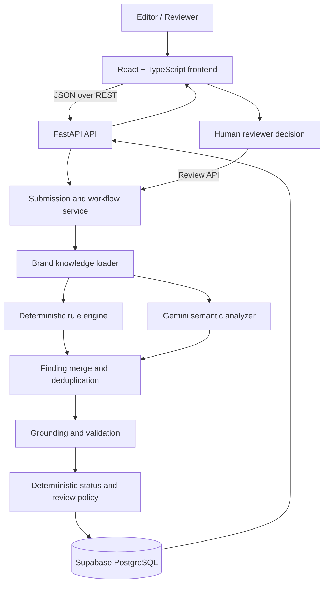
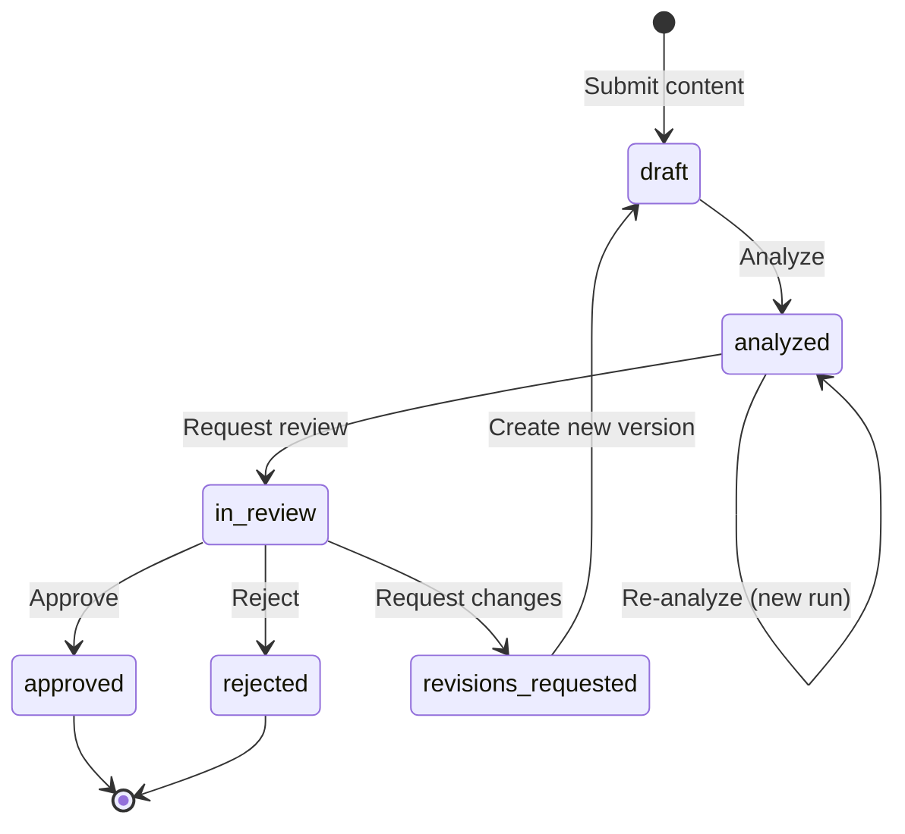

# Inkloom AI

> **Intelligent Brand-Governance Platform**  
> Evaluates submitted marketing and communication content against a brand's approved guidelines, facts, terminology and voice. It produces explainable findings and suggested corrections while preserving human authority over final approval.

**Live demo:** https://inkloom-ai-wheat.vercel.app/  
**Backend health:** https://inkloom-backend-upau.onrender.com/health

---

## 1. What Inkloom AI does

Inkloom AI helps teams review content before publication. A user can submit arbitrary text or start from one of the optional LumaCare sample templates. The sample templates only prefill the editor; every analysis evaluates the actual submitted text.

For each analysis, Inkloom AI aims to explain:

- **What was detected:** the exact quoted text or content span.
- **Why it matters:** the relevant approved brand rule, fact or terminology.
- **Evidence:** the authoritative statement retrieved from the selected brand's knowledge base.
- **Severity and classification:** for example, a confirmed rule violation, unsupported claim, potential issue or recommendation.
- **Suggested correction:** a practical alternative aligned with approved brand messaging.
- **Review requirement:** whether a human should inspect the result before publication.

The platform distinguishes a claim that is unsupported by the approved knowledge base from a claim proven factually false. Missing evidence is not proof of falsity. Overall compliance status is derived by backend validation, not accepted directly from the language model.

### Possible analysis outcomes

| Outcome | Meaning |
|---|---|
| `compliant` | No material verified issue or unresolved assessment limitation was found. |
| `needs_review` | The content contains an unsupported claim, potential issue, insufficient context or an analysis limitation that warrants human review. |
| `non_compliant` | A sufficiently severe, verified rule violation was identified. |

An analysis can also require human review independently of its overall status.

---

## 2. System architecture

Inkloom AI is implemented as a **modular monolith with a hybrid analysis pipeline**. The backend coordinates specialised components through internal Python interfaces. These components are not separate autonomous services or independently deployed agents.



### Main components and responsibilities

| Component | Responsibility | Inputs | Outputs |
|---|---|---|---|
| **Frontend client** | Collects content, shows brand knowledge, displays analysis evidence and supports revision/review actions. | Editor input and API responses. | REST requests; rendered results and workflow actions. |
| **FastAPI routers** | Expose the versioned JSON API and validate request/response contracts. | HTTP requests. | Typed JSON responses and structured errors. |
| **Submission service** | Owns submission creation, immutable version creation, analysis orchestration, review transitions and audit logging. | Submission commands and database session. | Persisted submissions, versions, runs, reviews and audit entries. |
| **Brand knowledge mapper** | Loads the selected brand's approved profile, guidelines, facts and terms into the analysis contract. | Active database records for a brand. | `BrandKnowledge` snapshot. |
| **Deterministic rule engine** | Detects explicit terminology, guarantees, timeframes, unsupported patterns and insufficient brand context using deterministic checks. | Submitted text and `BrandKnowledge`. | Rule findings and positive observations. |
| **Gemini semantic analyzer** | Evaluates contextual meaning, tone, nuanced claims and positive alignment. Uses structured JSON output validated against `AIAnalysisOutput`. | Submitted text and the same `BrandKnowledge`. | AI findings, positive observations and review signal. |
| **Finding merger** | Combines both sources and avoids reporting the same text span twice; deterministic rule findings take priority on overlap. | Rule and AI findings. | Combined finding set. |
| **Grounding validator** | Checks model references and quoted spans, downgrades unverified violations, and rebuilds evidence from approved database knowledge. | AI output, source text and `BrandKnowledge`. | Verified findings and correction notes. |
| **Status policy** | Derives `compliant`, `needs_review` or `non_compliant` and the human-review requirement. | Verified findings and AI status. | Final analysis decision. |
| **Persistence and audit layer** | Stores version-specific runs, findings, review decisions and append-only audit history. | Workflow events and analysis result. | Durable records retrievable after refresh. |

---

## 3. Agent responsibilities and orchestration

The project brief describes agent responsibilities and coordination. In the current implementation, these responsibilities are represented by **cooperating analysis components coordinated by the backend**, rather than multiple autonomous LLM agents. This keeps execution predictable, testable and auditable.

### Analysis roles

**1. Deterministic compliance role — Rule Engine**

- Checks explicit rules and known terminology patterns.
- Detects prohibited phrases and their supported variations.
- Checks guaranteed outcomes and unapproved timeframes.
- Evaluates whether text contains enough brand-specific substance for a meaningful assessment.
- Does not depend on Gemini being available.

**2. Semantic assessment role — Gemini**

- Reads the exact submitted content and selected brand knowledge.
- Evaluates tone, context, nuanced claims and messaging consistency.
- Identifies unsupported claims without treating missing evidence as proof of falsity.
- Returns structured findings and positive observations.
- Must not invent brand rules, IDs or evidence.

**3. Evidence and policy role — Grounding Validator**

- Validates every cited guideline, fact or terminology code against the supplied brand knowledge.
- Confirms that quoted text can be located in the submitted content.
- Downgrades a purported confirmed violation when its reference or quote cannot be verified.
- Reconstructs evidence from approved database statements.
- Prevents the model from deciding the final compliance status.

**4. Workflow and human-oversight role — Submission Service**

- Creates and preserves content versions.
- Starts analyses and records each analysis run.
- Enforces allowed workflow transitions.
- Records reviewer decisions and comments.
- Writes audit events so the lifecycle can be reconstructed.

### Orchestration sequence

For each analysis request, the backend follows this sequence:

1. Resolve the submission's **current immutable content version** and selected brand.
2. Build a brand knowledge object from the brand's approved profile, guidelines, facts and terms.
3. Run deterministic rules against the submitted text.
4. Send the same text and knowledge to Gemini for structured semantic analysis.
5. Validate the AI response shape with Pydantic.
6. Verify references and quoted spans against the supplied knowledge and content.
7. Merge and deduplicate rule and AI findings.
8. Derive the overall status and human-review requirement deterministically.
9. Persist the analysis run, findings, model/engine metadata and knowledge snapshot.
10. Return the saved result to the frontend.

The analysis is synchronous from the API caller's perspective and can take several seconds. Each re-analysis creates a new run; earlier runs are retained.

---

## 4. Communication interfaces

### Frontend ↔ backend

The frontend communicates with the FastAPI backend using **JSON over HTTP REST**. The API base URL is configured through `VITE_API_BASE_URL`. The API contract is documented in [docs/api-contract.md](docs/api-contract.md).

Key routes:

| Method | Endpoint | Purpose |
|---|---|---|
| `GET` | `/health` | Service and database health check. |
| `GET` | `/api/brands` | List available brand workspaces. |
| `GET` | `/api/brands/{slug}` | Retrieve brand profile and approved knowledge. |
| `POST` | `/api/submissions` | Create a submission and initial content version. |
| `GET` | `/api/submissions` | List submissions, optionally filtered by brand or status. |
| `GET` | `/api/submissions/{id}` | Retrieve versions, analysis history, reviews and allowed actions. |
| `POST` | `/api/submissions/{id}/versions` | Create the next immutable content version. |
| `POST` | `/api/submissions/{id}/analyze` | Analyse the current version and persist a new run. |
| `GET` | `/api/analysis-runs/{id}` | Retrieve a specific historical analysis run. |
| `POST` | `/api/submissions/{id}/review-request` | Submit an analysed version for human review. |
| `POST` | `/api/submissions/{id}/reviews` | Record approve, reject or request-changes decision. |
| `GET` | `/api/submissions/{id}/audit` | Retrieve the submission's audit history. |

The API uses UUIDs for records, ISO 8601 UTC timestamps and enumerated status values. Request and response types are defined in the backend Pydantic schemas and mirrored in the frontend TypeScript API types. Contract parity is checked by automated tests.

### Backend ↔ Gemini

The backend calls the Google GenAI SDK. The model is configured by the server-side `GEMINI_MODEL` environment variable; the current deployed configuration uses `gemini-3.6-flash`, with `gemini-3.1-flash-lite` as the secondary fallback.

The request includes:

- The submitted text, unchanged.
- The selected brand's approved guidelines, facts and terminology.
- System instructions that constrain the model to supplied knowledge.
- A Pydantic structured response schema (`AIAnalysisOutput`).
- JSON response mode and deterministic temperature configuration.

The Gemini API key is server-side only and must never be exposed in the frontend bundle or repository.

### Backend ↔ database

SQLAlchemy 2 is used for persistence in PostgreSQL hosted by Supabase. The deployed service connects through the Supabase Session Pooler. The local test suite uses SQLite with foreign-key checks enabled.

The database design and relationships are documented in [docs/database-schema.md](docs/database-schema.md).

---

## 5. Evidence correlation and trust model

Evidence correlation connects a detected problem to the specific approved knowledge that makes it relevant.

Each finding can include:

- `original_text`: a verbatim quote from the submitted content.
- `start_offset` and `end_offset`: the quote's location in the content, when locatable.
- `guideline_id`, `approved_fact_id` or `approved_term_id`: stable codes from the selected brand's knowledge base.
- `evidence`: server-generated text copied from the cited approved guideline or fact.
- `explanation`: why the quoted content needs attention.
- `suggestion`: a proposed brand-aligned correction.
- `confidence`, `severity`, `finding_type` and `source`: assessment metadata.

### Validation gates

1. **Schema gate:** the AI response must conform to `AIAnalysisOutput`. Invalid output is not stored as trusted AI findings.
2. **Reference gate:** every cited code must exist in the current `BrandKnowledge`. Unknown codes are removed and recorded in a reference note.
3. **Quote gate:** quoted text must be locatable in the submitted content. Unlocatable quotes cannot support a confirmed violation.
4. **Evidence gate:** evidence is rebuilt by the backend from approved source records. The model does not author authoritative evidence.
5. **Classification gate:** a confirmed violation requires a verified reference and located quote. An unsupported claim is not automatically upgraded to a confirmed violation.
6. **Status gate:** overall status is derived by backend policy, never copied from model output.

Every analysis run also stores a knowledge snapshot. This preserves the exact brand knowledge used for the decision, so historical findings remain interpretable if the brand profile changes later.

---

## 6. Error handling and resilience

The analysis pipeline is designed to preserve deterministic checks even when the external AI provider is unavailable.

### AI availability strategy

1. Call the configured primary Gemini model.
2. For a transient HTTP 503 capacity response, wait briefly and retry once.
3. If the primary model still fails, try the configured secondary Flash-Lite model.
4. If AI analysis still cannot complete, preserve deterministic findings and record the AI status as unavailable.
5. Derive the overall status and human-review requirement using backend policy. An unavailable AI analysis must not silently become an unconditional compliance approval.

The API records AI status separately from overall compliance status. Relevant AI states include `ok`, `unavailable`, `invalid_response` and `disabled`.

### API errors

Errors use a consistent JSON structure:

```json
{
  "error": {
    "code": "invalid_state",
    "message": "This submission is in review and cannot be edited.",
    "details": null
  }
}
```

Common HTTP responses:

| HTTP | Meaning |
|---|---|
| `404` | Requested brand, submission or analysis run does not exist. |
| `409` | Requested action is not allowed in the current workflow state. |
| `422` | Request validation failed. |
| `429` | Analysis rate limit exceeded. |
| `503` | Database unavailable. |
| `500` | Unexpected server error; detailed diagnostics remain server-side. |

The public `/health` endpoint reports service/database health and whether AI configuration is present. Its AI field is a configuration signal, **not a guarantee that a live Gemini inference request will succeed**.

---

## 7. Human review and content lifecycle

AI analysis is advisory. The reviewer retains final approval authority.



- A new edit creates a new content version; previous versions remain unchanged.
- Every analysis run is linked to the exact version it evaluated.
- Review decisions are linked to the reviewed version and analysis run.
- Rejections and requests for changes require reviewer comments.
- The server computes `allowed_actions`; the frontend only exposes actions permitted in the current state.
- Audit events record submission creation, version creation, analysis completion, review requests and review decisions.

---

## 8. Technology stack

| Layer | Technology |
|---|---|
| Frontend | React 19, TypeScript, Vite, Tailwind CSS v4, React Router |
| Backend | Python 3.13, FastAPI, Pydantic v2, SQLAlchemy 2 |
| Database | PostgreSQL on Supabase; SQLite for automated tests |
| AI | Google GenAI SDK, Gemini 3.6 Flash primary, Gemini 3.1 Flash Lite fallback |
| API interface | JSON over HTTP REST |
| Frontend deployment | Vercel |
| Backend deployment | Render |

### Repository layout

```text
inkloom-ai/
├── backend/
│   ├── app/
│   │   ├── routers/          # HTTP API endpoints
│   │   ├── services/         # Submission, analysis, rule and Gemini services
│   │   ├── models.py         # SQLAlchemy database models
│   │   ├── schemas.py        # Pydantic request/response contracts
│   │   ├── validation.py     # Grounding and status policy
│   │   ├── mappers.py        # Database records -> brand knowledge
│   │   └── seed.py           # Demo brand seed data
│   ├── tests/                # Backend and contract tests
│   └── requirements.txt
├── frontend/
│   ├── src/
│   │   ├── api/              # API client and TypeScript contracts
│   │   ├── components/       # Shared UI components
│   │   ├── data/             # Optional sample test templates
│   │   └── pages/            # Workspace, submit, detail, terms, privacy
│   └── vercel.json
├── docs/
│   ├── api-contract.md
│   └── database-schema.md
├── render.yaml
└── README.md
```

---

## 9. Demo brand and evaluation scenarios

The deployed public demo opens the preconfigured **LumaCare** skincare workspace. LumaCare is fictional, and its brand knowledge is illustrative.

| Code | Type | Approved knowledge |
|---|---|---|
| `GUIDE-001` | Outcome claim | Do not promise guaranteed medical or skincare outcomes. |
| `GUIDE-002` | Brand tone | Use friendly, reassuring and realistic messaging. |
| `GUIDE-003` | Factual consistency | Claims must be consistent with approved product information. |
| `FACT-001` | Approved fact | The product is designed to support clearer-looking skin. |
| `FACT-002` | Approved fact | No guaranteed acne-removal timeframe has been approved. |
| `TERM-001` | Terminology | Preferred: “supports clearer-looking skin”; prohibited: “guaranteed acne removal”. |

The workspace provides three optional one-click templates:

1. **Non-compliant:** guaranteed acne removal, a two-day timeframe and exaggerated results. Expected outcome: `non_compliant`.
2. **Compliant:** realistic copy using approved terminology and tone. Expected outcome: `compliant`.
3. **Partially compliant:** approved terminology combined with an unapproved seven-day claim. Expected outcome: `needs_review`.

Users can also submit completely original text. Contextually insufficient content is sent for review rather than automatically certified as compliant.

---

## 10. Local development

### Prerequisites

- Python 3.13
- Node.js and npm
- A PostgreSQL database for persistent local development, or a configured test database
- A Gemini API key for live semantic analysis (optional for deterministic-only operation and tests)

### Backend

```bash
cd backend
python3.13 -m venv .venv
source .venv/bin/activate
pip install -r requirements.txt

# Return to repository root and create local environment configuration
cd ..
cp .env.example backend/.env

# Edit backend/.env with local DATABASE_URL and GEMINI_API_KEY.
# Never commit secrets.

cd backend
pytest -v
uvicorn app.main:app --reload --port 8000
```

### Frontend

In a separate terminal:

```bash
cd frontend
npm install

# Configure the API base URL for local development.
# Set VITE_API_BASE_URL=http://localhost:8000 in frontend/.env.local.

npm run dev
```

Open http://localhost:5173.

### Useful checks

```bash
# Backend tests
cd backend && pytest -v

# Frontend quality checks
cd frontend
npm run lint
npm run build
```

---

## 11. Deployment configuration

The project is deployed as a frontend and backend connected to a managed PostgreSQL database.

### Supabase

- Create a PostgreSQL project.
- Use the Session Pooler connection string for Render.
- Configure the backend's `DATABASE_URL` with the SQLAlchemy Psycopg driver format.
- On startup, the application initialises tables and performs an idempotent LumaCare seed.

### Render backend

- Connect the GitHub repository as a Web Service, using the supplied `render.yaml`.
- Configure `DATABASE_URL`, `GEMINI_API_KEY`, `GEMINI_MODEL`, `GEMINI_TIMEOUT_SECONDS`, `CORS_ORIGINS` and other required settings from `.env.example`.
- Current primary model: `gemini-3.6-flash`.
- Health check path: `/health`.

### Vercel frontend

- Import the repository and set the root directory to `frontend`.
- Use the Vite framework preset.
- Set `VITE_API_BASE_URL` to the deployed Render backend URL.
- SPA routing is configured in `frontend/vercel.json`.

Do not commit `.env` files, database credentials or API keys. Configure secrets in the hosting provider's environment settings.

---

## 12. Known MVP limitations

- The public judging workspace is a single preconfigured LumaCare demo. The data model supports brand-specific knowledge, but the current navigation is centred on this demo workspace.
- The demo workspace does not require user authentication. It is intended for evaluation, not unrestricted production use with sensitive or confidential content.
- Render's free tier may spin down after inactivity, causing a cold start on the first request.
- Gemini availability and latency depend on Google's external API. Retry, secondary-model fallback and deterministic rules reduce, but do not eliminate, this dependency.
- Compliance findings are decision support, not legal, medical or regulatory certification. Human reviewers retain final authority.

---

## 13. Further documentation

- [API contract](docs/api-contract.md)
- [Database schema](docs/database-schema.md)

## 14. License

MIT License. Developed for the Round 2 Hackathon submission.
