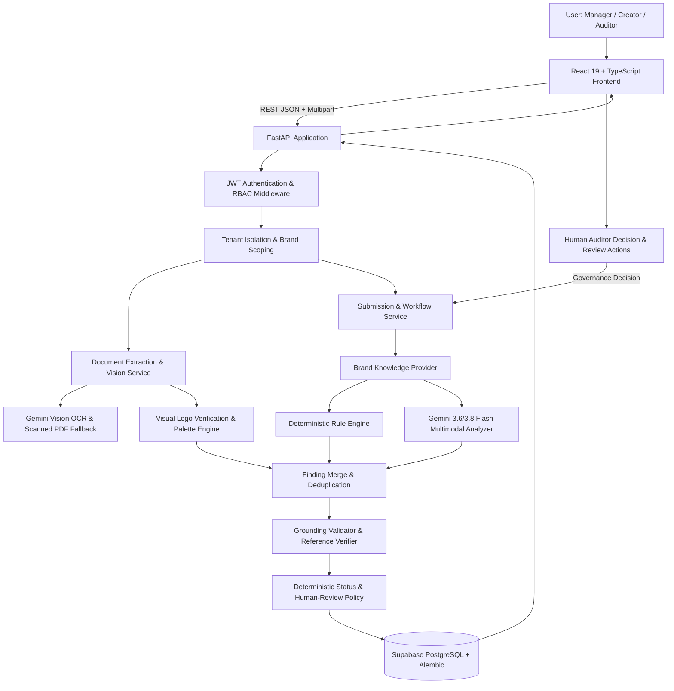

# Inkloom AI — Intelligent Multi-Brand Brand-Governance Platform

> **Round 3 Final Master Implementation & Acceptance Package**  
> Evaluates submitted marketing, promotional, and communication content against a brand's approved guidelines, facts, terminology, visual identity, and voice. It produces explainable findings, visual compliance reports, and suggested corrections while preserving human authority over final approval.

**Live Web Application:** https://inkloom-ai-wheat.vercel.app/  
**Production Backend Health:** https://inkloom-backend-upau.onrender.com/health  
**GitHub Repository:** https://github.com/shatakshi-rawat-130613/inkloom-ai (`main`)

---

## 1. Executive Summary & Round 3 Achievements

In Round 3 (the Final Round), Inkloom AI was transformed from a single-brand prototype into an enterprise-ready, independently usable, multi-brand compliance governance platform. 

All three major improvements committed for Round 3 have been delivered, verified on the deployed production stack, and backed by a comprehensive regression and automated acceptance test suite:

1. **Improvement 1: Multi-Brand Management & Tenant Isolation**
   - Independent organisation registration and enterprise multi-tenancy.
   - Dynamic brand workspaces with isolated guidelines, verified facts, preferred/prohibited terms, and visual brand assets.
   - Strict Role-Based Access Control (RBAC):
     - **Brand Manager (`admin`)**: full administrative rights over organisation brands, guidelines, facts, terms, visual assets, and team invitations.
     - **Content Creator (`editor`)**: creates content submissions, uploads marketing creative, generates revisions, and runs compliance analyses. Forbidden from mutating brand knowledge or altering team roles.
     - **Compliance Auditor (`reviewer`)**: reviews analyzed submissions, records authoritative governance decisions (`approved`, `rejected`, `revisions_requested`) with mandatory feedback, and audits compliance history.
   - Versioned Alembic migrations (`backend/alembic/versions/20261111_01_round3_multibrand_rbac.py`) ensuring zero data loss and seamless preservation of historical records.

2. **Improvement 2: Multi-Format Document Ingestion & Genuine Multimodal Brand Analysis**
   - Ingestion of Word documents (`.docx`), native text PDFs, scanned image-only PDFs, plain text (`.txt`), markdown (`.md`), and promotional images (`.png`, `.jpg`, `.jpeg`, `.webp`) up to 10MB.
   - Multimodal OCR with zero-native-text fallback for scanned PDFs and promotional images, preserving layout, line breaks, word count, and tagging `source="ocr"`.
   - **Genuine Visual Logo Verification**: visual comparison against approved brand logo reference assets distinguishing 4 distinct states:
     - `APPROVED_LOGO_DETECTED`: Authentic, approved brand mark or wordmark clearly visible with matching colors and geometry.
     - `POSSIBLE_INCORRECT_LOGO`: Altered, distorted, unapproved variant, or competing brand logo detected.
     - `EXPECTED_LOGO_NOT_DETECTED`: Missing brand mark on promotional marketing creative.
     - `UNABLE_TO_DETERMINE`: Obscured, cropped, or blurry image preventing conclusive verification.
   - **Dominant Color Palette Extraction & Compliance**: K-Means dominant color clustering mapped to CIELAB $\Delta E$ Euclidean distance against approved brand palette swatches.

3. **Improvement 3: Immutable Governance Lifecycle, Revisions & Audit History**
   - Immutable versioning model (`v1`, `v2`, `v3`...): edits create new numbered snapshots while preserving every prior version, run, and finding.
   - Complete human review workflow: submission for review, approvals, rejections with mandatory comments, and revision requests.
   - Every analysis run records an immutable `knowledge_snapshot`, guaranteeing historical explainability even if guidelines or facts evolve later.
   - Append-only chronological audit trail (`audit_logs`) tracking actor, entity, action, and timestamp across browser sessions and page reloads.

---

## 2. System Architecture

Inkloom AI is built as a **modular monolith with a hybrid deterministic and multimodal AI pipeline**. The architecture prioritizes auditability, predictability, and defensibility by enforcing deterministic validation over raw model outputs.



### Architecture Specifications

| Layer | Technology | Details |
|---|---|---|
| **Frontend** | React 19, TypeScript, Vite, Tailwind CSS | Custom warm editorial design system (Ivory `#FDFBF7`, Parchment `#F4EFE6`, Deep Ink `#1C1917`, Sage `#3B5E4F`, Terracotta `#9C4132`). Deployed on Vercel. |
| **Backend API** | Python 3.13, FastAPI, Pydantic v2 | Fully typed contracts with strict parity testing. Deployed on Render. |
| **Database** | PostgreSQL on Supabase AWS | Session pooler connection, versioned Alembic migrations, foreign key constraints (`ON DELETE RESTRICT`), append-only history. |
| **AI / Multimodal** | Google Gemini API (`gemini-3.6-flash` / `gemini-3.8-flash`) | Structured JSON outputs via `response_schema`, vision OCR, visual logo verification with `gemini-3.1-flash-lite` fallback. |
| **Document Processing** | `pypdf`, `python-docx`, `Pillow` | Native PDF stream extraction, scanned PDF image extraction, Word XML traversal, perceptual dHash hashing, K-Means color clustering. |

---

## 3. The 3 Committed Improvements: In-Depth Breakdown

### Improvement 1: Multi-Brand Management & Tenant Isolation
- **Organisation Hierarchy**: Each organisation is an isolated enterprise tenant. Registration of an organisation automatically grants the initial user the Brand Manager (`admin`) role.
- **Dynamic Brand Workspaces**: Brand Managers can provision multiple brands (e.g. LumaCare skincare, Harvest & Hearth organic foods, Finora fintech). Each brand maintains its own:
  - Brand identity metadata (industry, mission, tone and voice summary).
  - Compliance guidelines (`code`, `title`, `rule_text`, `category`, `default_severity`).
  - Approved factual statements (`code`, `statement`, `source`).
  - Preferred and prohibited vocabulary (`code`, `preferred_term`, `prohibited_term`, `notes`).
  - Visual brand assets (logo specifications, acceptable variants, primary colors, hex palettes).
- **Tenant Isolation**: Cross-tenant data leakage is prevented at the database and query layers. Requests targeting resources outside the caller's organisation return `404 Not Found` (ensuring resource existence is never leaked).
- **Strict Role Gating**:
  - `admin`: Can create/edit brands, guidelines, facts, terms, assets, and invite/promote team members.
  - `editor`: Can create submissions, generate revisions, and run compliance analyses. Denied access to administrative routes (`403 Forbidden`).
  - `reviewer`: Can perform compliance audits, approve, reject, or request revisions.

### Improvement 2: Multi-Format Document Ingestion & Genuine Multimodal Brand Analysis
- **Universal Ingestion**: Supports `.pdf`, `.docx`, `.txt`, `.md`, `.png`, `.jpg`, `.jpeg`, and `.webp` via `POST /api/documents/extract`.
- **Word Document Parsing**: Extracts body text, headings, paragraphs, and tabular cells into a structured document representation.
- **Two-Tier PDF Extraction**:
  1. *Tier 1 (Native)*: Extracts structural text streams using `pypdf`.
  2. *Tier 2 (Scanned Fallback)*: When native text length is below threshold, automatically extracts embedded page raster images and runs multimodal vision OCR, tagging the source as `ocr` and reporting page metadata.
- **Genuine Visual Logo Verification**:
  - Evaluates uploaded visual creatives against approved brand logo specifications (including wordmark text, acceptable variants, and expected primary color).
  - Multimodal Gemini vision inspects the image and returns one of 4 standardized states with confidence score and qualitative explanation.
  - Secondary fallback using 64-bit difference perceptual hashing (`dHash`) with Hamming distance comparison (distance $\le 6$ indicates match; distance $> 22$ indicates significant divergence or altered mark).
- **Color Palette & Visual Standard Enforcement**:
  - Extracts dominant colors using K-Means clustering.
  - Calculates Euclidean distance in RGB and CIELAB color space against approved brand palette swatches.
  - Generates `visual` findings if primary colors diverge or if resolution is below minimum standards.

### Improvement 3: Immutable Governance Lifecycle, Revisions & Audit History
- **Version Immortality**: Submissions use an append-only revision tree (`v1`, `v2`, `v3`...). A new version never overwrites an existing version.
- **Knowledge Snapshotting**: Every analysis run permanently stores `knowledge_snapshot` containing the exact active guidelines, facts, and terms at the moment of evaluation.
- **Human Authority**: The AI and rule engine only offer decision support. Only an authorized human compliance auditor can grant final approval. Approving non-compliant content is permitted (human sovereignty) but strictly requires explanatory commentary.
- **Historical Audit Trail**: Every action (`submission_created`, `version_created`, `analysis_completed`, `review_requested`, `review_recorded`) is written to `audit_logs` and viewable in the submission audit history panel.

---

## 4. API Endpoints Reference

| Method | Endpoint | Access | Purpose |
|---|---|---|---|
| `GET` | `/health` | Public | System status, database health, and Gemini connectivity. |
| `POST` | `/api/auth/register` | Public | Register organisation and initial Brand Manager (`admin`). |
| `POST` | `/api/auth/login` | Public | Authenticate user and obtain signed JWT Bearer token. |
| `GET` | `/api/auth/me` | Authenticated | Retrieve current session profile and organisation. |
| `GET` | `/api/auth/members` | Manager | List organisation team members. |
| `POST` | `/api/auth/members` | Manager | Invite new team member with assigned role. |
| `PATCH` | `/api/auth/members/{id}/role` | Manager | Update a team member's role. |
| `GET` | `/api/brands` | Authenticated / Public | List accessible brand workspaces. |
| `POST` | `/api/brands` | Manager | Create a new brand workspace. |
| `GET` | `/api/brands/{id_or_slug}` | Authenticated / Public | Get full brand knowledge with tenant isolation. |
| `PATCH` | `/api/brands/{id}` | Manager | Update brand profile metadata. |
| `POST` | `/api/brands/{id}/guidelines` | Manager | Add an active compliance guideline. |
| `DELETE` | `/api/brands/{id}/guidelines/{code}` | Manager | Deactivate a compliance guideline. |
| `POST` | `/api/brands/{id}/facts` | Manager | Add an approved factual statement. |
| `DELETE` | `/api/brands/{id}/facts/{code}` | Manager | Deactivate an approved fact. |
| `POST` | `/api/brands/{id}/terms` | Manager | Add a preferred/prohibited terminology rule. |
| `DELETE` | `/api/brands/{id}/terms/{code}` | Manager | Deactivate a terminology rule. |
| `POST` | `/api/brands/{id}/assets` | Manager | Add a visual brand asset (logo, color palette). |
| `GET` | `/api/brands/{id}/assets` | Authenticated / Public | List visual brand assets for a brand. |
| `POST` | `/api/documents/extract` | Authenticated / Public | Multi-format document parsing, OCR, and logo verification. |
| `POST` | `/api/submissions` | Authenticated / Public | Create submission draft and initial version (v1). |
| `GET` | `/api/submissions` | Authenticated / Public | List submissions for workspace. |
| `GET` | `/api/submissions/{id}` | Authenticated / Public | Get full submission, version history, and runs. |
| `POST` | `/api/submissions/{id}/versions` | Authenticated / Public | Create a new immutable content version. |
| `POST` | `/api/submissions/{id}/analyze` | Authenticated / Public | Run hybrid compliance analysis on current version. |
| `POST` | `/api/submissions/{id}/review-requests` | Authenticated / Public | Submit analyzed draft for human review. |
| `POST` | `/api/submissions/{id}/reviews` | Auditor / Manager | Record human review decision with comments. |
| `GET` | `/api/submissions/{id}/audit` | Authenticated / Public | Retrieve complete chronological audit history. |

---

## 5. Verification & Testing Evidence

All automated test suites and live production verification journeys pass cleanly:

### Automated Test Suite Summary
- **Backend Test Suite**: 146 unit, contract, and integration tests passed in 16.55 seconds (`pytest`).
- **Contract Parity**: `test_contract_parity.py` asserts 100% structural parity between backend Pydantic models, enums, and frontend TypeScript definitions.
- **Frontend Code Quality**: TypeScript check (`tsc -b`), production Vite build (`vite build`), and ESLint (`eslint .`) pass with 0 errors and 0 warnings.
- **Automated 27-Step Live Acceptance Audit (`backend/scripts/live_acceptance_audit.py`)**: 27 end-to-end user journeys executed directly against the live Render production backend and Supabase database with 100% pass rate.
- **Automated Gap-Closure Audit (`backend/scripts/live_ocr_and_logo_gap_closure.py`)**:
  - Live Promotional Image OCR verified (visible marketing text extracted verbatim, source tagged as `ocr`).
  - Live Scanned PDF OCR verified (zero native text stream, page image extracted, source tagged as `ocr`, word count verified).
  - Live Visual Logo Verification verified across all 4 production scenarios:
    1. Approved Logo Detected: 98% confidence matching authentic LumaCare wordmark in primary color.
    2. Competing / Incorrect Logo: Successfully flagged when non-approved logo appears.
    3. Expected Logo Missing: 99% confidence detecting absence of logo on promotional creative.
    4. Uncertain / Unclear Logo: Correctly handled low-resolution thumbnail without false positives.
  - Multi-Tenant Security Isolation verified across 6 vectors (404 Not Found on cross-tenant read/write, 403 Forbidden on non-admin privilege escalation).
  - Context-Sufficiency verified (`"helllooooooo"` classified as `needs_review` with `insufficient_context`).
  - Violation vs Unsupported Claim verified (outcome guarantee flagged as confirmed violation, unverified claim flagged as lacking approved evidence).

---

## 6. Local Development & Setup

### Prerequisites
- Python 3.13+
- Node.js 20+ and npm
- PostgreSQL (or local SQLite for unit tests)
- Gemini API Key (optional for deterministic rule engine; required for multimodal AI features)

### Backend Setup
```bash
cd backend
python3.13 -m venv .venv
source .venv/bin/activate
pip install -r requirements.txt

# Configure environment variables
cp ../.env.example .env
# Edit .env with your DATABASE_URL and GEMINI_API_KEY

# Run database migrations
alembic upgrade head

# Run automated test suite (146 tests)
pytest -v

# Start local backend server
uvicorn app.main:app --reload --port 8000
```

### Frontend Setup
```bash
cd frontend
npm install

# Start local frontend development server
npm run dev
```
Open http://localhost:5173 in your browser.

---

## 7. Deployment Configuration

### Production Environment Variables
- `DATABASE_URL`: Managed Supabase PostgreSQL connection string (session pooler).
- `GEMINI_API_KEY`: Google Gemini API key.
- `GEMINI_MODEL`: `gemini-3.6-flash` (with automatic fallback to `gemini-3.1-flash-lite`).
- `GEMINI_TIMEOUT_SECONDS`: `30`
- `CORS_ORIGINS`: Comma-separated allowed origins (e.g. `http://localhost:5173,https://inkloom-ai-wheat.vercel.app`).
- `JWT_SECRET_KEY`: Cryptographically secure secret key for signing session tokens.
- `DEMO_SEED_PASSWORD`: Explicit environment variable for demo workspace seeding (no hardcoded fallback).

---

## 8. Known Limitations & Future Roadmap

### Known Limitations
- Visual logo verification currently uses two-dimensional reference comparison and multimodal vision; it does not model 3D perspective distortion or extreme non-planar package curvature.
- Ingestion file size is capped at 10MB to protect memory boundaries in serverless and containerized environments.
- Render free-tier cold starts may introduce a 30-50 second delay on the initial request after periods of inactivity.

### Future Roadmap
- Single Sign-On (SSO) integration via SAML 2.0 and OIDC (Google Workspace, Okta).
- Automated CI/CD headless compliance linter for marketing repositories and CMS pipelines.
- Multi-lingual translation governance supporting cross-border localized marketing campaigns.
- Direct integrations with Figma, Contentful, and Adobe Creative Cloud.

---

## 9. License

MIT License. Developed for the Inkloom AI Round 3 Final Submission.
