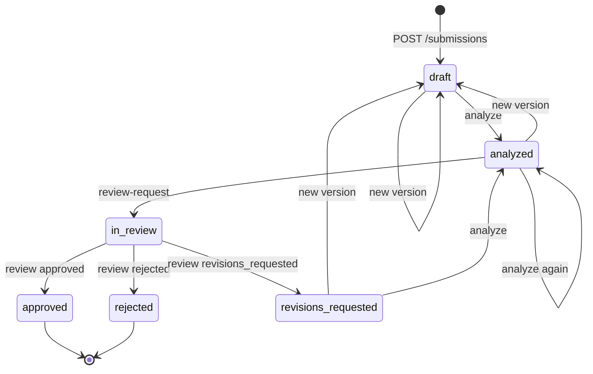

# API Contract (v1)

Sources of truth: [`backend/app/schemas.py`](../backend/app/schemas.py), [`backend/app/enums.py`](../backend/app/enums.py), mirrored in [`frontend/src/api/types.ts`](../frontend/src/api/types.ts). `backend/tests/test_contract_parity.py` fails on drift. Changes require coordinator approval.

- Base path: `/api`. JSON only. No authentication (public demo workspace).
- UUIDs as strings, datetimes ISO 8601 UTC.
- Nullable fields are always present as `null`, never omitted.
- Brand knowledge is identified by stable code. `Finding.guideline_id`, `approved_fact_id`, `approved_term_id` hold codes such as `GUIDE-001`.

## Enumerations

| Enum | Values |
|---|---|
| `ContentType` | social_post, email, web_page, advertisement, product_description, press_release, other |
| `SubmissionStatus` | draft, analyzed, in_review, approved, rejected, revisions_requested |
| `OverallStatus` | compliant, needs_review, non_compliant |
| `FindingType` | confirmed_rule_violation, unsupported_claim, potential_issue, recommendation |
| `Severity` | critical, high, medium, low, informational (UI shows capitalised labels) |
| `FindingCategory` | terminology, outcome_claim, factual_consistency, timeframe, tone, other |
| `FindingSource` | rule_engine, ai |
| `AIStatus` | ok, unavailable, invalid_response, disabled |
| `ReviewDecision` | approved, rejected, revisions_requested |
| `SubmissionAction` | edit, analyze, request_review, review |

## Submission lifecycle



`allowed_actions` on `SubmissionDetail` is computed server-side from this table. The frontend shows only those actions.

| Status | allowed_actions |
|---|---|
| draft | edit, analyze |
| analyzed | edit, analyze, request_review |
| in_review | review |
| revisions_requested | edit, analyze |
| approved, rejected | none (final) |

Rules: analysis always targets the **current** version; re-analysing the same version creates a new run and keeps the old one. A review is recorded against the current version and its latest run. Approving a `non_compliant` run is allowed (the reviewer is the final authority) but requires `comments`.

## Analysis status policy

Derived deterministically in `app/validation.py`, never copied from the model:

- **non_compliant**: any `confirmed_rule_violation` of severity medium or higher.
- **needs_review**: any `unsupported_claim`, any low-severity confirmed violation, any `potential_issue` of medium or higher, or AI analysis did not complete (`ai_status != ok`).
- **compliant**: otherwise.

`requires_human_review` is true when status is not compliant, AI did not complete, the model asked for review, or the validator corrected any reference.

## Endpoints

### `GET /health` and `GET /api/health`
200 → `HealthResponse` `{ status: "ok", database: "ok" | "unavailable", ai: AIStatus }`. Used by Render and the frontend warm-up call. `ai` reports configuration (`disabled` when no key), not a live model call.

### `GET /api/brands`
200 → `BrandSummary[]`.

### `GET /api/brands/{slug}`
Path: `slug` (for example `lumacare`). 200 → `BrandDetail` (guidelines, facts, terms). 404 `not_found`.

### `POST /api/submissions`
Body `SubmissionCreate`:
```json
{ "brand_id": "uuid", "title": "Spring launch post", "content_type": "social_post",
  "body": "Text up to 10,000 characters", "author_name": "Demo Editor" }
```
Creates the submission and version 1 with status `draft`. Does **not** analyse. 201 → `SubmissionDetail`. 404 brand, 422 validation.

### `GET /api/submissions`
Query: `brand_id?` (uuid), `status?` (SubmissionStatus), `limit` (1 to 100, default 50), `offset` (default 0). Sorted by `updated_at` descending. 200 → `SubmissionListItem[]`.

### `GET /api/submissions/{id}`
200 → `SubmissionDetail` (all versions, all run summaries, latest run for current version in full, all reviews, allowed_actions). 404.

### `POST /api/submissions/{id}/versions`
Body `VersionCreate` `{ "body": "...", "change_note": "Removed timeframe" }`. Creates version N+1, sets status `draft`. 201 → `SubmissionDetail`. 404, 409 `invalid_state` (in_review, approved, rejected), 422.

### `POST /api/submissions/{id}/analyze`
No body. Runs rule engine + Gemini on the current version, persists the run and findings, sets status `analyzed` (or keeps `revisions_requested` → `analyzed`). 201 → `AnalysisRun`. 404, 409 `invalid_state`, 429 `rate_limited`. **Gemini failure is not an error**: the run is stored with rule-engine findings and `ai_status` set to `unavailable`, `invalid_response` or `disabled`. Synchronous; expect several seconds.

### `GET /api/analysis-runs/{id}`
200 → `AnalysisRun` (used to view or compare historical runs). 404.

### `POST /api/submissions/{id}/review-request`
Body `ReviewRequestCreate` `{ "requested_by": "Demo Editor", "note": null }` (body optional). Requires status `analyzed` and at least one run on the current version. Sets `in_review`. 200 → `SubmissionDetail`. 404, 409.

### `POST /api/submissions/{id}/reviews`
Body `ReviewCreate` `{ "decision": "revisions_requested", "reviewer_name": "Demo Reviewer", "comments": "Remove the 7 day claim." }`. `comments` required unless `approved`, and also required when approving a `non_compliant` run. Requires status `in_review`. Sets status to the decision. 201 → `SubmissionDetail`. 404, 409, 422.

### `GET /api/submissions/{id}/audit`
200 → `AuditLogEntry[]` oldest first. 404.

## Errors

All non-2xx responses use `ErrorResponse`:
```json
{ "error": { "code": "invalid_state", "message": "This submission is in review and cannot be edited.", "details": null } }
```

| HTTP | code | When |
|---|---|---|
| 404 | `not_found` | Unknown brand, submission or run |
| 409 | `invalid_state` | Action not allowed in current status |
| 422 | `validation_error` | Body or query invalid. `details` lists `{ loc, msg }` per field |
| 429 | `rate_limited` | Too many analyses from one client (default 10 per minute) |
| 503 | `database_unavailable` | Database connection failure |
| 500 | `internal_error` | Unexpected error. Message is generic; details are logged server-side only |

## AI contract

Gemini is called with `response_schema = AIAnalysisOutput` (`summary`, `findings[]`, `positive_observations[]`, `requires_human_review`). Each `AIFinding` has `category, severity, finding_type, original_text, guideline_id, approved_fact_id, explanation, suggestion, confidence`. The model does not set overall status, evidence, offsets or source.

Every response passes two gates before storage:
1. **Shape**: Pydantic validation. Failure → `ai_status = invalid_response`, rule-engine findings only.
2. **Grounding**: `app/validation.verify_ai_findings` (see module docstring). Unknown codes removed and noted, unlocatable quotes noted, unbacked violations downgraded, evidence rebuilt from the database, em dashes normalised.
