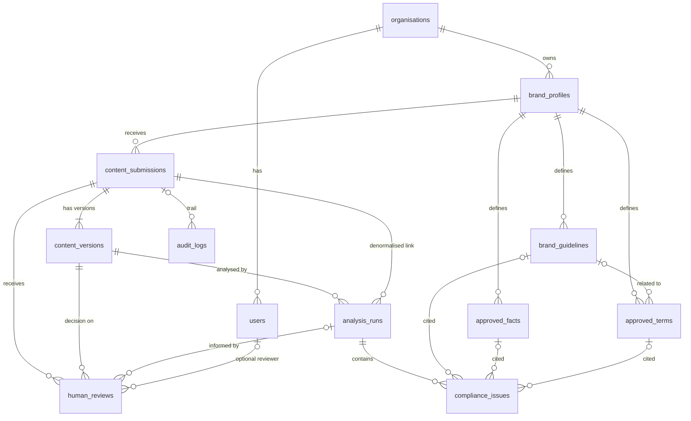

# Database Schema

Source of truth: [`backend/app/models.py`](../backend/app/models.py). Strategy: SQLAlchemy `create_all()` plus idempotent seed (no Alembic for the MVP). Changes require coordinator approval.

## Principles

- UUID primary keys, `created_at` on every table (UTC, timezone-aware).
- Brand knowledge rows also carry a stable `code` (GUIDE-001, FACT-001, TERM-001), unique per brand. The API and Gemini only ever see codes.
- **Append-only history.** Versions, analysis runs, findings and reviews are never updated or deleted by the application. All foreign keys are `ON DELETE RESTRICT`.
- Enums are `VARCHAR(32)` with `CHECK` constraints (portable to SQLite for tests). Values are listed in [`api-contract.md`](api-contract.md#enumerations).
- Finding references to guidelines, facts and terms are real foreign keys, so a fabricated reference cannot be stored.

## Relationships

## Tables

| Table | Key columns | Constraints and indexes |
|---|---|---|
| `organisations` | name, slug | slug unique |
| `users` | organisation_id, display_name, email, role | email unique. Seeded demo identities only, no auth |
| `brand_profiles` | organisation_id, name, slug, industry, description, voice_summary, is_demo, updated_at | slug unique |
| `brand_guidelines` | brand_id, code, title, rule_text, category, default_severity, is_active | unique (brand_id, code) |
| `approved_facts` | brand_id, code, statement, source, is_active | unique (brand_id, code) |
| `approved_terms` | brand_id, code, preferred_term, prohibited_term, notes, related_guideline_id, is_active | unique (brand_id, code) |
| `content_submissions` | brand_id, title, content_type, status, current_version_number, author_name, updated_at | index (brand_id, updated_at), index status |
| `content_versions` | submission_id, version_number, body, change_note | unique (submission_id, version_number). Immutable |
| `analysis_runs` | submission_id, **version_id**, overall_status, summary, positive_observations (JSON), requires_human_review, ai_status, model_name, rule_engine_version, knowledge_snapshot (JSON), duration_ms | index version_id, index (submission_id, created_at) |
| `compliance_issues` | analysis_run_id, position, source, category, severity, finding_type, original_text, start_offset, end_offset, guideline_id, approved_fact_id, approved_term_id, evidence, explanation, suggestion, confidence, reference_note | index analysis_run_id |
| `human_reviews` | submission_id, version_id, analysis_run_id, reviewer_id, reviewer_name, decision, comments | index (submission_id, created_at), index version_id |
| `audit_logs` | submission_id, entity_type, entity_id, action, actor_name, details (JSON) | index (entity_type, entity_id, created_at), index submission_id |

`analysis_runs.knowledge_snapshot` stores the exact `BrandKnowledge` supplied to the run, so a historical finding stays explainable even if a guideline is later edited.

### Audit actions

`submission_created`, `version_created`, `analysis_completed`, `review_requested`, `review_recorded`.

## Deliberately omitted

`brand_assets` from the original outline is **not created**. It only serves P2 visual analysis. Because the strategy is `create_all()`, adding it later is a non-breaking new table.
