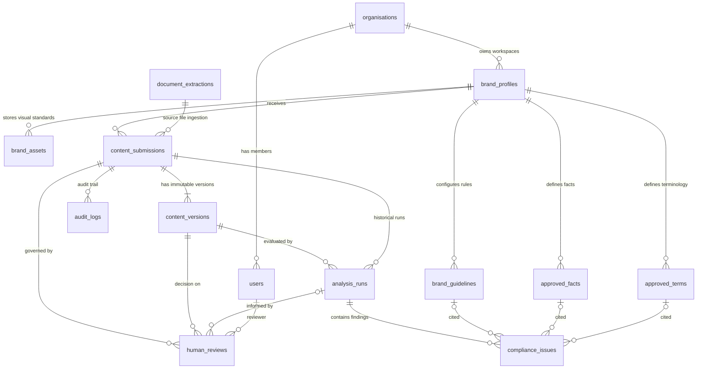

# Database Schema (Round 3 Final)

Source of truth: [`backend/app/models.py`](../backend/app/models.py).  
Migration strategy: Versioned additive **Alembic migrations** preserving all historical records, submissions, analysis runs, and audit logs. Never reset or recreate the production database.

---

## 1. Principles

- **UUID primary keys**, timezone-aware UTC `created_at` timestamps across all tables.
- **Strict Multi-Tenant Isolation**: Every brand profile belongs to an `organisation_id`. Users are scoped to their organization. Cross-tenant access is blocked at the database query and service layers.
- **Append-only governance history**: Submissions, immutable content versions, analysis runs, findings, and human reviews are preserved. Versions and runs are never updated or deleted by the application.
- **Foreign-Key Integrity**: Finding references (`guideline_id`, `approved_fact_id`, `approved_term_id`) point to real database rows with `ON DELETE RESTRICT`. Fabricated references cannot be stored.
- **Historical Explainability**: `analysis_runs.knowledge_snapshot` captures the exact active guidelines, facts, and terminology at the exact moment analysis ran. Even if brand rules evolve later, historical audits remain fully verifiable.
- **Database Migrations**: Managed via Alembic (`backend/alembic/versions/`). All schema evolutions are versioned, non-destructive, and additive.

---

## 2. Entity-Relationship Architecture

---

## 3. Database Tables Reference

| Table | Key Columns | Constraints and Indexes | Description |
|---|---|---|---|
| `organisations` | `id`, `name`, `slug`, `created_at` | `slug` UNIQUE | Top-level tenant container. |
| `users` | `id`, `organisation_id`, `display_name`, `email`, `password_hash`, `role`, `is_active` | `email` UNIQUE, FK to `organisations.id` | Authenticated tenant users with PBKDF2 password hashes and RBAC roles (`admin`, `editor`, `reviewer`). |
| `brand_profiles` | `id`, `organisation_id`, `name`, `slug`, `industry`, `description`, `voice_summary`, `is_demo`, `created_at`, `updated_at` | `slug` UNIQUE, FK to `organisations.id` | Brand workspaces with isolated guidelines, facts, terms, and assets. |
| `brand_guidelines` | `id`, `brand_id`, `code`, `title`, `rule_text`, `category`, `default_severity`, `is_active` | UNIQUE (`brand_id`, `code`), FK to `brand_profiles.id` | Brand-specific compliance rules (e.g. `GUIDE-001`). |
| `approved_facts` | `id`, `brand_id`, `code`, `statement`, `source`, `is_active` | UNIQUE (`brand_id`, `code`), FK to `brand_profiles.id` | Verified brand factual statements (e.g. `FACT-001`). |
| `approved_terms` | `id`, `brand_id`, `code`, `preferred_term`, `prohibited_term`, `notes`, `related_guideline_id`, `is_active` | UNIQUE (`brand_id`, `code`), FK to `brand_profiles.id` | Preferred and prohibited brand vocabulary. |
| `brand_assets` | `id`, `brand_id`, `asset_type`, `asset_name`, `asset_metadata` (JSONB/JSON), `is_active` | FK to `brand_profiles.id`, Index (`brand_id`, `asset_type`) | Visual brand identity assets: approved logo references, perceptual dHash signatures, and color palettes. |
| `document_extractions` | `id`, `file_name`, `file_type`, `file_size_bytes`, `extraction_source`, `extracted_text`, `extraction_status`, `extraction_metadata` (JSONB/JSON) | Index (`created_at`) | Ingested files (PDF, DOCX, PNG, JPG, WebP), OCR extractions, and visual compliance records. |
| `content_submissions` | `id`, `brand_id`, `title`, `content_type`, `status`, `current_version_number`, `author_name`, `created_at`, `updated_at` | FK to `brand_profiles.id`, Index (`brand_id`, `updated_at`), Index `status` | Marketing copy or campaign submission records. |
| `content_versions` | `id`, `submission_id`, `version_number`, `body`, `change_note`, `created_at` | UNIQUE (`submission_id`, `version_number`), FK to `content_submissions.id` | Immutable content snapshots. Every edit increments `version_number`. |
| `analysis_runs` | `id`, `submission_id`, `version_id`, `overall_status`, `summary`, `positive_observations` (JSON), `requires_human_review`, `ai_status`, `model_name`, `rule_engine_version`, `knowledge_snapshot` (JSON), `duration_ms`, `created_at` | FK to `content_submissions.id`, FK to `content_versions.id`, Index (`submission_id`, `created_at`) | Audit-proof analysis results tied directly to the analyzed version. |
| `compliance_issues` | `id`, `analysis_run_id`, `position`, `source`, `category`, `severity`, `finding_type`, `original_text`, `start_offset`, `end_offset`, `guideline_id`, `approved_fact_id`, `approved_term_id`, `evidence`, `explanation`, `suggestion`, `confidence`, `reference_note` | FK to `analysis_runs.id`, FK to `brand_guidelines.id`, FK to `approved_facts.id`, FK to `approved_terms.id`, Index `analysis_run_id` | Granular issue findings with exact text spans and citations. |
| `human_reviews` | `id`, `submission_id`, `version_id`, `analysis_run_id`, `reviewer_id`, `reviewer_name`, `decision`, `comments`, `created_at` | FK to `content_submissions.id`, FK to `content_versions.id`, FK to `analysis_runs.id`, Index (`submission_id`, `created_at`) | Human governance decisions (`approved`, `rejected`, `revisions_requested`). |
| `audit_logs` | `id`, `submission_id`, `entity_type`, `entity_id`, `action`, `actor_name`, `details` (JSON), `created_at` | FK to `content_submissions.id`, Index (`entity_type`, `entity_id`, `created_at`) | Immutable chronological audit trail. |

---

## 4. Audit Trail Actions

- `submission_created`: First content draft created.
- `version_created`: New immutable revision submitted.
- `analysis_completed`: Deterministic rule engine and Gemini evaluation finished.
- `review_requested`: Submission forwarded to human reviewer queue.
- `review_recorded`: Human reviewer decision logged with mandatory comments.
